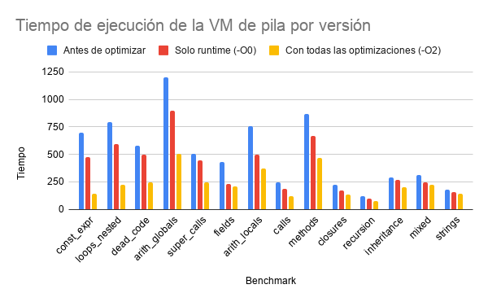
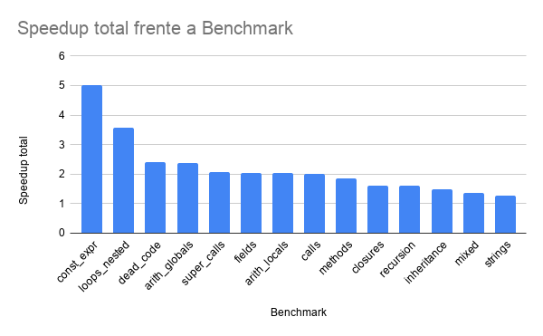
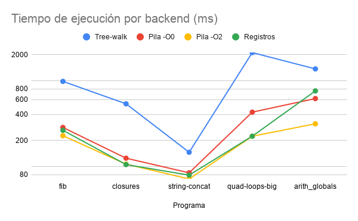

# rlox — Entrega final

## Objetivo

`rlox` es una implementación de Lox en Rust que combina las dos etapas vistas
en clase:

1. un intérprete **tree-walk**, que ejecuta directamente el AST;
2. un compilador a **bytecode**, seguido por una máquina virtual.

La entrega final parte del intérprete de la entrega parcial y lo amplía. El
scanner, el parser y el AST se conservan; sobre ese frontend se agregaron el
compilador, una VM de pila y una VM de registros. El tree-walk se mantiene como
backend funcional y como referencia para comprobar la semántica de la VM.

## Estructura del proyecto

```text
archivo o REPL
    -> Scanner
    -> Parser
    -> AST
         ├── Checker (análisis semántico y validaciones)
         ├── Resolver -> Interpreter (tree-walk)
         ├── Compiler -> bytecode -> Stack VM
         └── Codegen  -> bytecode -> Register VM
```

| Ruta | Responsabilidad |
| --- | --- |
| `src/frontend/` | Scanner, tokens, parser y AST |
| `src/interpreter/` | Checker, resolver, ambientes e intérprete tree-walk |
| `src/compiler/mod.rs` | Compilación del AST a bytecode |
| `src/compiler/chunk.rs` | Instrucciones, constantes y líneas del bytecode |
| `src/compiler/vm.rs` | Máquina virtual basada en pila |
| `src/compiler/reg/` | Generador y máquina virtual basada en registros |
| `src/compiler/class.rs` | Clases e instancias del tree-walk |
| `src/compiler/vm_class.rs` | Clases e instancias de la VM |
| `src/compiler/opt.rs` | Configuración de optimizaciones |
| `tests/` | Pruebas unitarias, de integración y de paridad |
| `real-tests/` | Pruebas de la cátedra |
| `benchmarks/` | Programas y herramientas de medición |

### Refactorización de la estructura

Para pasar de la entrega parcial a la final se reorganizó el código en tres
partes:

- **`frontend`**: es la parte que recibe el texto del programa, lo separa en
  tokens y construye el AST. Es la entrada del lenguaje.
- **`interpreter`**: contiene el intérprete tree-walk, que recorre ese AST y
  ejecuta el programa directamente.
- **`compiler`**: transforma el AST en bytecode y contiene las máquinas
  virtuales que lo ejecutan.

Esta separación permite reutilizar el frontend en los distintos backends y
evita mezclar el análisis del programa con su ejecución.

La distribución es propia. No se copian los nombres ni la organización interna
de `plox`; se siguen solamente los lineamientos generales del trabajo práctico.

## Qué se hizo para la entrega final

### Compilador

El compilador recibe el AST producido por el frontend y lo transforma en un
chunk de bytecode. Durante esta etapa:

- genera instrucciones para expresiones y sentencias;
- administra constantes;
- calcula offsets para saltos;
- crea prototipos para funciones y closures;
- reserva slots para variables locales;
- genera instrucciones para llamadas, métodos, clases y herencia.

El compilador comparte el scanner, parser, checker y AST con el tree-walk. Así,
el cambio de ejecución no requiere duplicar el lenguaje.

### Chunk de bytecode

Un chunk representa el programa compilado. Contiene:

- una secuencia lineal de instrucciones;
- una tabla de constantes;
- información de líneas para reportar errores;
- prototipos anidados para funciones y closures.

Esta representación reemplaza el recorrido repetido del árbol durante la
ejecución por un recorrido de instrucciones compactas. También permite
inspeccionar el programa compilado con `RLOX_DISASSEMBLE`:

```bash
RLOX_DISASSEMBLE=1 cargo run -- --vm examples/fib.lox
```

### VM de pila

La VM principal ejecuta el bytecode usando:

- una pila de valores;
- call frames para las llamadas;
- closures y upvalues;
- tablas de globales;
- objetos para clases, instancias y métodos.

El backend de pila es el backend completo de bytecode. Soporta funciones,
closures, clases, campos, métodos, `this`, herencia y `super`.

Se ejecuta con:

```bash
cargo run -- --vm examples/ahorro.lox
```

### VM de registros

Además de la VM de pila se implementó un backend experimental basado en registros (mencionado en clase).
Su objetivo es comparar dos modelos de ejecución:

- en la VM de pila, las instrucciones consumen y producen valores en una pila;
- en la VM de registros, las instrucciones indican explícitamente los registros
  fuente y destino.

La comparación permite analizar cómo cambia el despacho, la cantidad de
movimientos de valores y el costo de las llamadas al cambiar la representación
del bytecode. También sirve como alternativa para estudiar qué operaciones son
costosas en la VM de pila.

La VM de registros comparte el frontend, pero tiene su propio chunk, codegen,
closures y runtime. Todavía no soporta clases ni herencia (programación orientada
a objetos), por lo que programas con clases son rechazados en tiempo de
compilación.

Se ejecuta con:

```bash
cargo run -- --reg examples/fib.lox
```

### Conservación del tree-walk

El tree-walk no se eliminó. Se ejecuta por defecto:

```bash
cargo run -- examples/ahorro.lox
```

Esto permite comparar:

```text
AST -> Interpreter
AST -> Compiler -> Stack VM
AST -> Codegen  -> Register VM
```

La resolución estática calcula la profundidad de las variables locales. El
interpreter usa esa información para acceder a los ambientes y el compilador la
usa para generar accesos a slots. Los closures conservan el entorno correcto en
ambos caminos.

## Clases y herencia

La VM de pila y el tree-walk soportan programación orientada a objetos:

- declaración de clases;
- creación de instancias;
- campos;
- métodos;
- inicializador `init`;
- `this`;
- herencia simple mediante `class B < A`;
- llamadas a métodos heredados mediante `super`.

La resolución valida usos incorrectos de `this` y `super`, y el runtime informa
errores como heredar de un valor que no es una clase o acceder a un método
inexistente. Las pruebas se encuentran principalmente en
`tests/parity_tests.rs` y `tests/vm_tests.rs`.

## Pruebas

Las pruebas unitarias e integración se ejecutan con:

```bash
cargo test
```

Incluyen scanner, parser, AST, checker, resolver, interpreter, VM, compilación,
optimización y paridad entre tree-walk y VM.

La suite de la cátedra se ejecuta con:

```bash
./tests.sh
```

También se pueden seleccionar backends:

```bash
./tests.sh --tree
./tests.sh --vm
./tests.sh --reg
./tests.sh --vm --reg -v
```

Las pruebas de paridad ejecutan los mismos programas en tree-walk y VM de pila y
comparan salida estándar y errores. Esto ayuda a detectar diferencias
introducidas durante el pasaje del AST al bytecode.

## Uso básico

```bash
cargo build
cargo test
cargo run -- examples/ahorro.lox
cargo run -- --vm examples/ahorro.lox
cargo run -- --reg examples/ahorro.lox
```

Para compilar en modo release:

```bash
cargo build --release --bin rlox --bin rlox-bench
```

## Uso real: simulador de ahorro

Más allá de las pruebas automáticas, `rlox` puede ejecutar programas con un objetivo concreto. El archivo `examples/ahorro.lox` simula la evolución de un ahorro durante 12 meses y determina si alcanza un objetivo definido.

```lox
fun crear_interes(tasa) {
  fun aplicar_interes(saldo) {
    return saldo + saldo * tasa;
  }
  return aplicar_interes;
}

fun alcanza_objetivo(saldo, objetivo) {
  if (saldo >= objetivo) {
    return true;
  }
  return false;
}

var saldo = 500;
var objetivo = 700;
var meses = 0;
var aplicar_interes = crear_interes(0.02);

while (meses < 12) {
  saldo = aplicar_interes(saldo);
  meses = meses + 1;
}

print "Saldo despues de 12 meses:";
print saldo;

if (alcanza_objetivo(saldo, objetivo)) {
  print "Objetivo alcanzado";
} else {
  print "Objetivo no alcanzado";
}
```

Se ejecuta con cualquiera de los tres backends:

```bash
cargo run -- examples/ahorro.lox        # tree-walk
cargo run -- --vm examples/ahorro.lox   # VM de pila
cargo run -- --reg examples/ahorro.lox  # VM de registros
```

La salida es:

```
Saldo despues de 12 meses:
634.1208972812726
Objetivo no alcanzado
```

Este ejemplo muestra que el lenguaje puede expresar un programa completo con un objetivo concreto, no solamente evaluar expresiones aisladas. En particular, combina:

- **Variables y asignaciones** (`var`, `=`)
- **Operaciones aritméticas** sobre números de punto flotante
- **Funciones con parámetros y retorno**
- **Condicionales** (`if`/`else`) y un **bucle** (`while`)
- **Closures**: `crear_interes` devuelve la función interna `aplicar_interes`, que conserva el valor de `tasa` del entorno donde fue definida. Cada llamada en el bucle aplica el mismo interés porque la función captura la variable del scope externo.

## Decisiones de diseño y arquitectura

A partir de la experiencia de la entrega parcial y de las sugerencias del docente evaluador, se consolidaron las siguientes decisiones de diseño estructurales en `rlox`:

### 1. Parser de expresiones: Algoritmo de Pratt en lugar de descenso recursivo anidado
En la implementación inicial del frontend, el análisis sintáctico de expresiones utilizaba descenso recursivo clásico mediante una cadena de métodos anidados por cada nivel de precedencia.

Para la entrega final, se refactorizó el módulo en [`src/frontend/parser/pratt.rs`](src/frontend/parser/pratt.rs) adoptando el **algoritmo de Vaughan Pratt (*Pratt parsing*)** guiado por una tabla de reglas de precedencia y asociatividad. Esta idea se obtuvo por mencion del docente en clase.

De esta manera la incorporación de nuevos operadores (como el operador ternario `?:`, módulo `%` o asignaciones compuestas) se reduce a agregar una entrada en la tabla de precedencias, sin alterar la estructura gramatical del parser. 

### 2. Separación de `checker` frente a `resolver` (análisis semántico modular)
En la entrega parcial, los chequeos semánticos estáticos (como el rechazo de sentencias `return` fuera de funciones y la detección de declaraciones autorreferenciadas tipo `var a = a;`) se ejecutaban dentro del `Resolver`.

> **Observación del docente:**
> *«Me gusta el lanzar un error frente a los return top-level! Solamente no se si me convence dónde está ubicado. El resolver es el nombre que le damos a una pasada de análisis semántico que resuelve variables, mientras que esto caería en otra pasada. O bien renombrar el archivo a algo más genérico o separarlo a un archivo nuevo con una pasada nueva, logrando una arquitectura más extensible donde equivalen una pasada por el árbol a un análisis semántico en particular».*

Siguiendo esta sugerencia, se optó por **separar los chequeos en un módulo independiente ([`src/interpreter/checker.rs`](src/interpreter/checker.rs)) con su propia pasada sobre el AST**, en lugar de simplemente renombrar el `resolver`. Gracias a esto tenemos:

* **Principio de Responsabilidad Única (SRP):** El `resolver` conserva su rol estricto separado.
* **Sub-visitors modulares y extensibles:** El nuevo `checker` descompone las validaciones en pasadas autocontenidas. Si a futuro se agregan nuevas restricciones del lenguaje, se implementa un sub-visitor específico sin ensuciar la lógica de resolución de ámbitos.

### 3. Patrón Visitor para expresiones y sentencias
Los nodos `Expr` y `Stmt` contienen exclusivamente datos sintácticos estructurados, mientras que las operaciones (`Checker`, `Resolver`, `Interpreter`, `Compiler`) se implementan como Visitors desacoplados. Esto evita contaminar las estructuras de datos con lógica de ejecución y deja abierto el compilador a nuevos pases de optimización o inspección sin modificar los nodos del AST.

### 4. Desazucarado sintáctico (*Desugaring*)
El parser transforma las construcciones de alto nivel como los bucles `for` en combinaciones equivalentes de bloques y bucles `while`. De este modo, los backends de ejecución (tanto el Tree-Walk como las máquinas virtuales) solo necesitan implementar una primitiva de bucle, reduciendo la superficie de código y simplificando las optimizaciones.

### 5. Elección de Rust como lenguaje anfitrión
* **Seguridad de memoria determinista:** Rust gestiona los recursos mediante pertenencia (*ownership*) y destrucción determinista (RAII), evitando las pausas de un Garbage Collector global. En el Tree-Walk, los entornos de ejecución se modelan mediante conteo de referencias (`Rc<RefCell<Environment>>`), lo cual prescinde de un recolector pero retiene memoria si se acumulan cadenas de clausuras en el heap. En las VMs, en cambio, los valores residen en pilas y registros que se reciclan de forma compacta.
* **Sistema de tipos expresivo y exhaustivo:** El uso de enumerados (`enum`) y pattern matching exhaustivo obliga al compilador a verificar que todas las variantes de tokens, expresiones, sentencias e instrucciones de bytecode estén contempladas, erradicando estados inválidos en tiempo de ejecución.
* **Abstracciones de costo cero (*Zero-Cost Abstractions*):** Los patrones de diseño y los iteradores de Rust se compilan a código de máquina plano en modo `--release`, alcanzando un rendimiento cercano a C.

### 6. Pila explícita de estados de función (`Vec<FnState>`) en lugar de árbol de compiladores
En *Crafting Interpreters*, la compilación de funciones anidadas y closures se modela en C enlazando estructuras `Compiler` mediante punteros crudos (`struct Compiler* enclosing;`), formando una cadena o árbol de compiladores sobre la pila de llamadas del sistema.

En Rust, reproducir esa estructura con referencias mutables enlazadas choca contra las reglas de pertenencia y tiempos de vida (*lifetimes*) del *borrow checker*. Por este motivo, en `rlox` ([`src/compiler/mod.rs`](src/compiler/mod.rs)) se adoptó un enfoque idiomático:

* **Un único `Compiler` con una pila de estados (`Vec<FnState>`):** Toda la compilación es coordinada por una sola estructura que mantiene una pila dinámica de funciones en progreso.
* **Apilado y desapilado al anidar funciones:** Al ingresar a compilar una función o closure, se apila un nuevo estado (`self.fns.push(FnState::new(...))`) con su propio `FnProto`, tabla de variables locales (`locals`) y profundidad de ámbito.
* **Emisión sobre el tope:** Todas las operaciones de emisión de bytecode (`emit`, `add_constant`, etc.) operan sobre el tope de la pila (`self.fns.last_mut()`).
* **Resolución limpia de *upvalues*:** Para resolver variables capturadas por cierres, el compilador inspecciona hacia atrás los elementos de la pila `self.fns` desde el tope hacia la base, encadenando upvalues de forma lineal sin requerir punteros complejos.
* **Finalización:** Al concluir la función, se desapila con `self.fns.pop()`, se registra el prototipo resultante en la tabla de constantes de la función contenedora y se emite la instrucción `OP_CLOSURE`.


## Optimizaciones de la VM de pila

El trabajo de rendimiento se hizo sobre la VM de pila (`--vm`). Se partió de una línea de base fija (commit `3cc44bc`, tag `opt-baseline`, con el lenguaje completo y sin optimizar) y cada optimización se midió contra la versión anterior. Todas conservan la semántica: mismos mensajes de error, mismas líneas reportadas y mismo orden de evaluación.

### Qué se optimizó

Hay dos grupos. Las mejoras de **runtime** están siempre activas. Las de **compilador** se controlan con `-O0`, `-O1` y `-O2` (sin ningún flag se usa `-O0`).

| Optimización | Grupo | Qué hace | Efecto medido (aislada) |
| :--- | :---: | :--- | :--- |
| `Value` compacto | runtime | Las funciones del tree-walk pasan a `Rc`, y `Value` baja de 120 a 24 bytes. Cada push, pop y clone mueve menos memoria. | 1,2× a 1,6× |
| Aritmética en el lugar | runtime | Las operaciones binarias escriben el resultado sobre el operando izquierdo en vez de hacer pop, pop y push. | 1 % a 6 % (poco, cerca del ruido) |
| Llamadas más baratas | runtime | Se elimina un clone del callee, se despacha por referencia y los frames se reservan de antemano. | 1,08× a 1,21× |
| `SetProperty` en el lugar | runtime | Si el campo ya existe se actualiza sin crear un `String` para la clave. | 1,8× a 1,95× al asignar campos existentes |
| Constant folding | compilador | Las subexpresiones constantes (`(10 + 20) * 3`) se calculan al compilar. Lo que daría error en ejecución no se pliega. | 1,44× en `const_expr` |
| Eliminación de código muerto | compilador | Se poda `if (false)`, `while (false)` y lo que sigue a un `return`. | 1,21× en `dead_code` |
| Simplificación de saltos | compilador | Encadena saltos que apuntan a otros saltos y elimina los redundantes. | Sin mejora medible en la suite |
| `Invoke` directo | compilador y VM | `obj.metodo(args)` se ejecuta sin crear un `BoundMethod` en el heap. | 1,24× en `methods` |
| `SuperInvoke` directo | compilador y VM | Lo mismo para `super.metodo(args)`. | 1,66× en `super_calls` |
| Globales indexados | compilador y VM | Cada global tiene un slot en un vector, así que se evita calcular el hash del nombre en cada acceso. | 1,87× en `arith_globals` |
| Superinstrucciones `AddLocalConst` y `LessLocalConst` | compilador y VM | `i + 1` e `i < n` pasan de tres instrucciones a una. | 2,02× en `loops_nested` |
| Superinstrucción `SetLocalPop` | compilador y VM | `i = i + 1;` como sentencia fusiona la asignación con el descarte del valor. | 1,41× en `loops_nested` |

Se probaron y descartaron otras dos: un peephole genérico sobre el bytecode (ganancia esperada menor a 1 % y riesgo al recalcular saltos) y `JumpIfFalsePop` (regresión reproducible del 7 % en `calls`). La simplificación de saltos queda en el código porque es correcta, pero no mejoró ningún benchmark.

### Benchmark optimizaciones

Las mejoras en optimizaciones se midieron con `rlox-bench`, que mide solo la ejecución en memoria. Cada cifra es la mediana de 15 repeticiones intercaladas después de 5 de calentamiento, en milisegundos, compilado en `--release`. Las columnas son la línea de base, la versión actual con las optimizaciones de compilador apagadas (`-O0`, que ya incluye las de runtime) y la actual con todo activo (`-O2`).

| Benchmark | Base (ms) | `-O0` (ms) | `-O2` (ms) | Speedup total |
| :--- | ---: | ---: | ---: | ---: |
| `const_expr` | 696,1 | 473,3 | 139,1 | **5,00×** |
| `loops_nested` | 796,6 | 594,0 | 224,1 | **3,56×** |
| `dead_code` | 578,8 | 495,5 | 242,4 | 2,39× |
| `arith_globals` | 1198,1 | 897,2 | 504,9 | 2,37× |
| `super_calls` | 507,5 | 441,9 | 246,9 | 2,06× |
| `fields` | 427,4 | 227,3 | 209,2 | 2,04× |
| `arith_locals` | 755,4 | 500,3 | 373,9 | 2,02× |
| `calls` | 243,4 | 183,8 | 122,1 | 1,99× |
| `methods` | 868,5 | 667,3 | 471,1 | 1,84× |
| `closures` | 220,7 | 169,6 | 137,0 | 1,61× |
| `recursion` | 118,8 | 98,6 | 74,4 | 1,60× |
| `inheritance` | 292,4 | 265,9 | 199,4 | 1,47× |
| `mixed` | 308,7 | 245,8 | 226,2 | 1,37× |
| `strings` | 175,3 | 154,4 | 139,1 | 1,26× |

**Figura 1.** Tiempo de ejecución de la VM de pila en milisegundos por versión (Base, `-O0` y `-O2`).



**Figura 2.** Factor de aceleración (*Speedup*) total alcanzado con `-O2` frente a la línea de base.



Media geométrica de los 14 speedups:

- **Runtime** (base a `-O0`): 1,31×.
- **Compilador** (`-O0` a `-O2`): 1,55×.
- **Total** (base a `-O2`): **2,03×**, o sea que el tiempo de ejecución baja a la mitad.

Ninguno de los 14 benchmarks empeoró. Las ganancias son grandes en código aritmético, con constantes, con globales y en bucles. Son chicas en `strings` y `mixed`, donde el costo está en la memoria y no en el despacho de instrucciones.

#### Interpretación de los gráficos

- **Descenso sostenido (Figura 1):** En todos los casos se observa una reducción escalonada del tiempo: primero por las mejoras de runtime (`-O0`) y luego un salto todavía mayor con los pases del compilador (`-O2`).
- **Picos en aritmética y bucles (Figura 2):** Los mayores factores de aceleración ocurren en `const_expr` (5,00×) y `loops_nested` (3,56×), donde el *constant folding* y las superinstrucciones eliminan directamente la emisión y despacho de instrucciones repetitivas.
- **Límite en operaciones de memoria:** En `strings` (1,26×) y `mixed` (1,37×) la aceleración es menor porque el costo principal reside en la reserva y copia de memoria en el heap, cuello de botella que las optimizaciones a nivel bytecode no pueden evitar.

### Cómo reproducirlo

```bash
cargo build --release --bin rlox --bin rlox-bench

# Un benchmark, en -O0 y en -O2
rlox-bench --backend vm -O0 --reps 15 --warmup 5 benchmarks/programs/loops_nested.lox
rlox-bench --backend vm -O2 --reps 15 --warmup 5 benchmarks/programs/loops_nested.lox

# Suite completa a CSV
rlox-bench --backend vm -O2 --csv benchmarks/results/final_o2.csv

# Probar un solo pase, o apagar uno
rlox --vm -O0 --opt=fold programa.lox
rlox --vm -O2 --no-opt=super programa.lox
```

Los pases son `fold`, `dce`, `jumps`, `super`, `invoke` y `globals`.

# Benchmark: comparación de los cuatro backends

Se compararon los cuatro caminos de ejecución del proyecto sobre cinco
programas. El tree-walk fue el backend más lento en todos los casos. La VM de
pila con `-O2` fue la más rápida en cuatro programas y la VM de registros quedó
prácticamente empatada con ella en `closures` y `quad-loops-big`.

## Qué se compara

Los cuatro backends comparten scanner, parser y checker. Lo que cambia es la
forma de ejecutar el AST:

| Backend | Flag | Descripción |
| --- | --- | --- |
| Tree-walk | ninguno | Recorre el AST y lo evalúa directamente. |
| VM de pila sin optimizar | `--vm -O0` | Compila a bytecode de pila. Incluye mejoras del runtime, pero no aplica pases del compilador. |
| VM de pila optimizada | `--vm -O2` | Compila a bytecode y aplica `fold`, `dce`, `jumps`, `super`, `invoke` y `globals`. |
| VM de registros | `--reg` | Usa bytecode de tres direcciones, con registros explícitos en lugar de una pila. No aplica optimizaciones y todavía no soporta clases. |

La VM de registros se incluye para comparar dos representaciones de bytecode:
la VM de pila realiza operaciones sobre valores temporales de la pila, mientras
que la VM de registros indica directamente los operandos y el destino de cada
instrucción. El objetivo es observar cuánto influye la arquitectura de
ejecución, separándola del efecto de los pases de optimización.

## Programas medidos

| Programa | Qué ejercita |
| --- | --- |
| `fib.lox` | `fib(30)` recursivo y llamadas a funciones |
| `closures.lox` | Creación y uso de closures |
| `string-concat.lox` | Concatenación de cadenas |
| `quad-loops-big.lox` | Bucles anidados y operaciones repetitivas sobre locales |
| `arith_globals.lox` | Aritmética y accesos a variables globales |

`fib.lox`, `string-concat.lox` y `quad-loops-big.lox` están en
`examples/`. Los otros dos programas están en `benchmarks/programs/`.

## Metodología

Se utilizó `hyperfine` con dos calentamientos descartados y diez mediciones por
comando, sobre binarios compilados en modo `--release`. Se midió el proceso
completo:

- inicio del ejecutable;
- lectura y análisis del programa;
- compilación a bytecode, cuando corresponde;
- ejecución;
- finalización del proceso.

El comando utilizado fue:

```bash
for f in examples/fib.lox benchmarks/programs/closures.lox examples/string-concat.lox \
         examples/quad-loops-big.lox benchmarks/programs/arith_globals.lox; do
  hyperfine -w 2 -r 10 \
    "./target/release/rlox $f" \
    "./target/release/rlox --vm -O0 $f" \
    "./target/release/rlox --vm -O2 $f" \
    "./target/release/rlox --reg $f"
done
```

Los resultados se expresan como media ± desviación estándar. La máquina de
medición utilizó WSL sobre Windows. Como los tiempos dependen del hardware y de
la carga del sistema, lo más importante para esta comparación son las
relaciones entre backends, no los valores absolutos.

Los programas con clases no se
incluyen porque la vm de registros todavía no implementa esas construcciones.

## Resultados

**Tabla 1.** Tiempo de ejecución en milisegundos. Menor es mejor.

| Programa | Tree-walk | Pila `-O0` | Pila `-O2` | Registros |
| --- | ---: | ---: | ---: | ---: |
| `fib` | 974,9 ± 37,3 | 283,8 ± 24,9 | **227,5 ± 12,1** | 263,1 ± 8,5 |
| `closures` | 534,7 ± 15,6 | 124,6 ± 10,3 | 106,3 ± 7,7 | **105,0 ± 7,6** |
| `string-concat` | 146,0 ± 17,4 | 84,2 ± 4,2 | **71,4 ± 2,0** | 79,2 ± 1,2 |
| `quad-loops-big` | 2108 ± 50 | 427,5 ± 20,5 | **224,3 ± 17,3** | 224,5 ± 8,7 |
| `arith_globals` | 1362 ± 46 | 615,5 ± 29,7 | **313,0 ± 14,8** | 755,5 ± 51,2 |

**Tabla 2.** Factor relativo respecto del backend más rápido de cada programa.
El mejor resultado vale `1,00`. Menor es mejor.

| Programa | Tree-walk | Pila `-O0` | Pila `-O2` | Registros |
| --- | ---: | ---: | ---: | ---: |
| `fib` | 4,29 ± 0,28 | 1,25 ± 0,13 | **1,00** | 1,16 ± 0,07 |
| `closures` | 5,09 ± 0,40 | 1,19 ± 0,13 | 1,01 ± 0,10 | **1,00** |
| `string-concat` | 2,05 ± 0,25 | 1,18 ± 0,07 | **1,00** | 1,11 ± 0,04 |
| `quad-loops-big` | 9,40 ± 0,76 | 1,91 ± 0,17 | **1,00** | 1,00 ± 0,09 |
| `arith_globals` | 4,35 ± 0,25 | 1,97 ± 0,13 | **1,00** | 2,41 ± 0,20 |

Los factores de la Tabla 2 son los que informa `hyperfine`; no se calcularon
cocientes adicionales. Cuando la diferencia queda dentro del margen de error,
se considera un empate práctico. Por ejemplo, en `quad-loops-big` la diferencia
entre `-O2` y registros es demasiado pequeña para afirmar que un backend sea
realmente más rápido.

**Figura 3.** Tiempo de ejecución por backend en escala logarítmica (menor es mejor).



## Interpretación

1. **Tree-walk:** es el más lento en los cinco programas. Esto es consistente
   con su modelo de ejecución: recorre nodos del AST durante cada operación,
   mientras que las VMs ejecutan una secuencia lineal de instrucciones.
2. **Pila `-O0` contra registros:** Ninguna aplica
   pases de optimización del compilador. Registros empata o mejora a `-O0` en
   varios casos, aunque es claramente peor en `arith_globals`.
3. **Efecto de `-O2`:** la VM de pila optimizada es la más rápida en cuatro de
   los cinco programas. La mejora es especialmente grande en
   `quad-loops-big` y `arith_globals`, donde se benefician las superinstrucciones
   y los globales indexados descritos en la sección siguiente.
4. **Registros contra pila `-O2`:** ambos empatan prácticamente en
   `closures` y `quad-loops-big`. La pila optimizada gana en `fib`,
   `string-concat` y, con mucha diferencia, en `arith_globals`.

Estos resultados muestran que el modelo de registros puede ser competitivo aun
sin optimizaciones, pero también que los pases del compilador tienen un efecto
importante en los programas adecuados. No permiten concluir que una arquitectura
sea siempre mejor: los resultados dependen del programa, del runtime y de las
optimizaciones disponibles para cada backend.

## Benchmark externo: Fibonacci contra Python y C

Además de comparar los cuatro backends de `rlox`, se ejecutó el mismo algoritmo
de Fibonacci recursivo en Python y en C. El objetivo es tener referencias
externas de rendimiento:

- Python representa un lenguaje interpretado de propósito general;
- C representa un programa compilado a código nativo;
- los cuatro comandos de `rlox` permiten observar el efecto de pasar del
  tree-walk a bytecode y de aplicar optimizaciones.

Todos los programas calculan `fib(30)`. El programa Lox es
[`examples/fib.lox`](examples/fib.lox).

### Metodología

Se compiló `rlox` en modo release y el programa C con `gcc -O2`. Luego se
utilizó `hyperfine` con dos calentamientos descartados y diez mediciones:

```bash
cargo build --release --bin rlox
gcc -O2 fib.c -o fib_c

hyperfine -w 2 -r 10 \
  './target/release/rlox examples/fib.lox' \
  './target/release/rlox --vm -O0 examples/fib.lox' \
  './target/release/rlox --vm -O2 examples/fib.lox' \
  './target/release/rlox --reg examples/fib.lox' \
  'python3 -c "fib = lambda n: n if n <= 1 else fib(n-2) + fib(n-1); print(fib(30))"' \
  './fib_c'
```

La medición incluye el tiempo completo del proceso. Por lo tanto, incluye
arranque, lectura del archivo, análisis, compilación cuando corresponde y
ejecución.

### Resultados

| Implementación | Tiempo medio | Desviación estándar |
| --- | ---: | ---: |
| `rlox` tree-walk | 934,6 ms | ± 26,7 ms |
| `rlox` VM de pila `-O0` | 266,1 ms | ± 6,3 ms |
| `rlox` VM de pila `-O2` | **231,0 ms** | ± 19,5 ms |
| `rlox` VM de registros | 270,9 ms | ± 21,1 ms |
| Python 3 | 176,6 ms | ± 17,0 ms |
| C (`gcc -O2`) | **2,3 ms** | ± 0,6 ms |

Tomando C como referencia, los factores relativos aproximados son:

| Implementación | Veces más lenta que C |
| --- | ---: |
| C (`gcc -O2`) | **1,00×** |
| Python 3 | 76,70× |
| `rlox` VM de pila `-O2` | 100,31× |
| `rlox` VM de pila `-O0` | 115,55× |
| `rlox` VM de registros | 117,64× |
| `rlox` tree-walk | 405,90× |

### Análisis del rendimiento

- **C compilado:** `fib_c` tarda 2,3 ms porque `gcc -O2` transforma el programa
  en instrucciones nativas antes de ejecutarlo. La recursión no se interpreta
  mediante un AST ni mediante una máquina virtual general. Por eso C funciona
  como una referencia del costo mínimo aproximado para este algoritmo.
- **Tree-walk:** es el resultado más lento de `rlox`, con 934,6 ms. En cada
  llamada recursiva, el intérprete vuelve a recorrer nodos del AST y realiza
  despacho entre los distintos tipos de expresiones y sentencias. Además, las
  variables se resuelven mediante ambientes enlazados; en Rust esos ambientes
  utilizan `Rc<RefCell<Environment>>`, lo que agrega indirecciones y chequeos de
  préstamo durante la ejecución.
- **VM de pila:** `-O0` baja el tiempo a 266,1 ms porque el programa ya no se
  ejecuta recorriendo el árbol: primero se compila a una secuencia lineal de
  bytecode y luego la VM la despacha. La opción `-O2` baja el tiempo a 231,0 ms
  al aplicar optimizaciones del compilador, aunque en esta medición la
  variación es mayor (±19,5 ms).
- **VM de registros:** tarda 270,9 ms. Su representación de tres direcciones
  evita parte de los movimientos implícitos de una pila, pero este backend no
  tiene los pases de optimización de `-O2`. En Fibonacci queda cerca de la VM de
  pila `-O0`, por lo que este programa no muestra una ventaja clara de una
  arquitectura sobre la otra.
- **Python:** tarda 176,6 ms y resulta más rápido que los backends de `rlox` en
  esta prueba. Python tampoco recorre el AST original durante la ejecución:
  compila el código a bytecode y lo ejecuta en una VM implementada en C. Además,
  su runtime de funciones, objetos y llamadas recursivas está muy optimizado. Esto podria explicar por qué una VM propia de bytecode todavía puede ser más
  lenta que Python, aunque ambas utilicen bytecode.

La comparación muestra el efecto del cambio de representación:

```text
AST + ambientes          -> tree-walk       -> 934,6 ms
bytecode de pila         -> VM -O0         -> 266,1 ms
bytecode de registros    -> VM de registros-> 270,9 ms
bytecode de pila + pases -> VM -O2         -> 231,0 ms
bytecode de Python       -> CPython        -> 176,6 ms
código nativo            -> gcc -O2        ->   2,3 ms
```

Los factores relativos indican que la VM de pila `-O2` es aproximadamente
100 veces más lenta que C y que el tree-walk es aproximadamente 406 veces más
lento. Esto no significa que C sea “100 veces mejor” que `rlox` como lenguaje:
es una comparación puntual entre implementaciones distintas del mismo
algoritmo.

Finalmente, C tarda menos de 5 ms. Hyperfine advierte que en ese rango el ruido
del sistema tiene un peso importante, por lo que el valor de C y los factores
calculados a partir de él deben interpretarse como referencias aproximadas.

## Benchmark comparativo: rlox contra plox y ploxb (quad-loops.lox)

Para evaluar el impacto combinado de la **arquitectura de ejecución** (Tree-Walk frente a Máquina Virtual de bytecode) y del **lenguaje anfitrión** (Python dinámico frente a Rust compilado nativo), se compararon las implementaciones disponibles en la materia sobre el programa [`examples/quad-loops.lox`](examples/quad-loops.lox).

Este programa ejecuta dos bucles `while` anidados con un total de 100.000 iteraciones internas ($1.000 \times 100$), evaluando aritmética simple y manipulación de variables sin requerir soporte de funciones:

### Metodología

La medición se realizó utilizando `hyperfine` con 2 corridas de calentamiento (*warmup*) y un mínimo de 5 ejecuciones por comando, ejecutando desde la raíz del proyecto:

```bash
hyperfine \
  --warmup 2 \
  --min-runs 5 \
  -n "plox (Tree-Walk / Python)"       "plox rlox/examples/quad-loops.lox" \
  -n "ploxb (Bytecode VM / Python)"    "ploxb rlox/examples/quad-loops.lox" \
  -n "rlox (Tree-Walk / Rust)"         "./rlox/target/release/rlox rlox/examples/quad-loops.lox" \
  -n "rlox (Stack VM -O2 / Rust)"      "./rlox/target/release/rlox --vm -O2 rlox/examples/quad-loops.lox"
```

### Resultados obtenidos

| Implementación | Tecnología / Arquitectura | Tiempo Medio (mean ± σ) | Rango (min … max) | Muestras | Rendimiento Relativo |
| :--- | :--- | ---: | ---: | :---: | :---: |
| **`rlox` (Stack VM `-O2`)** | Rust nativo (Stack VM optimizada) | **3,1 ms ± 0,6 ms** | 2,4 ms … 6,2 ms | 740 | **1,00× (Base más rápida)** |
| **`rlox` (Tree-Walk)** | Rust nativo (Recorrido de AST) | **23,1 ms ± 2,5 ms** | 20,7 ms … 32,7 ms | 119 | ~7,36× más lento |
| **`ploxb`** | Python 3 (Bytecode VM) | **1117,0 ms ± 150,0 ms** | 1029,0 ms … 1381,0 ms | 5 | ~355,95× más lento |
| **`plox`** | Python 3 (Tree-Walk) | **1516,0 ms ± 29,0 ms** | 1484,0 ms … 1558,0 ms | 5 | ~483,01× más lento |

Según el resumen estadístico de `hyperfine`:
* `rlox` (Stack VM `-O2`) fue **~7,36 veces más rápido** que `rlox` (Tree-Walk).
* `rlox` (Stack VM `-O2`) fue **~356 veces más rápido** que `ploxb` (Bytecode VM en Python).
* `rlox` (Stack VM `-O2`) fue **~483 veces más rápido** que `plox` (Tree-Walk en Python).
* `rlox` (Tree-Walk en Rust) fue **~48 veces más rápido** que la VM de bytecode en Python (`ploxb`) y **~65 veces más rápido** que `plox`.

### Análisis comparativo

1. **Efecto de la arquitectura en el mismo lenguaje anfitrión:**
   * **En Python (`plox` vs. `ploxb`):** El compilador a bytecode de `ploxb` reduce el tiempo de ejecución de 1516 ms a 1117 ms (un speedup de **~1,36×**). Eliminar el recorrido recursivo del AST y la sobrecarga del patrón Visitor produce una mejora sensible, pero limitada por el hecho de que la máquina virtual sigue ejecutándose sobre el bucle de interpretación y los tipos dinámicos de CPython.
   * **En Rust (`rlox` Tree-Walk vs. `rlox` Stack VM `-O2`):** La transición de recorrer el AST a despachar bytecode lineal en una VM con optimizaciones (`-O2`) reduce el tiempo de 23,1 ms a 3,1 ms (**~7,36×** de aceleración). Al estar implementada en código nativo, la VM de Rust puede aprovechar la representación compacta de valores en la pila y la fusión de instrucciones sin la penalización de un intérprete subyacente.

2. **Efecto del lenguaje anfitrión (Host Language Overhead):**
   * El resultado más revelador surge al contrastar `rlox` (Tree-Walk) contra `ploxb` (Bytecode VM): **el intérprete tree-walk en Rust fue 48 veces más rápido que la máquina virtual de bytecode en Python**.
   * Esto evidencia que el costo de abstracción de un lenguaje dinámico de alto nivel (despacho dinámico de métodos, conteo de referencias, asignación de objetos `PyObject` en el heap para enteros y flotantes, y el propio loop de evaluación de CPython) supera con creces la ganancia algorítmica de compilar a bytecode lineal si este último corre interpretado sobre Python.

3. **Optimizaciones de compilación en código nativo:**
   * `rlox` compilado con `--release` se beneficia de la vectorización, inlining de métodos y eliminación de chequeos innecesarios realizada por LLVM. En contraste, `plox` y `ploxb` están sujetos a las decisiones dinámicas de CPython en tiempo de ejecución.

## Impacto de la compilación nativa (Debug vs. Release)

Por sugerencia del docente evaluador, se diseñó este benchmark para poner a prueba empíricamente la hipótesis de que el flag `--release` produce una mejora sustancial en el rendimiento de `rlox`.

Se ejecutó el mismo programa [`examples/quad-loops.lox`](examples/quad-loops.lox) comparando los binarios generados por `cargo build` (modo desarrollo / debug, sin optimizar) frente a `cargo build --release` (modo producción, con `-O3`):

```bash
hyperfine --warmup 2 --min-runs 10 \
  -n "Tree-Walk (Debug)"      "./target/debug/rlox examples/quad-loops.lox" \
  -n "Tree-Walk (Release)"    "./target/release/rlox examples/quad-loops.lox" \
  -n "Stack VM -O2 (Debug)"   "./target/debug/rlox --vm -O2 examples/quad-loops.lox" \
  -n "Stack VM -O2 (Release)" "./target/release/rlox --vm -O2 examples/quad-loops.lox"
```

### Resultados obtenidos

| Backend | Perfil de Compilación | Tiempo Medio (mean ± σ) | Rango (min … max) | Factor de Aceleración con `--release` |
| :--- | :--- | ---: | ---: | :---: |
| **Tree-Walk** | Debug (`opt-level = 0`) | 177,7 ms ± 4,0 ms | 172,4 ms … 187,3 ms | Base Debug |
| **Tree-Walk** | Release (`opt-level = 3`) | **22,5 ms ± 1,4 ms** | 20,9 ms … 30,9 ms | **~7,90× más rápido** |
| **Stack VM (`-O2`)** | Debug (`opt-level = 0`) | 16,7 ms ± 0,8 ms | 15,4 ms … 20,6 ms | Base Debug |
| **Stack VM (`-O2`)** | Release (`opt-level = 3`) | **2,8 ms ± 0,5 ms** | 2,2 ms … 7,3 ms | **~5,92× más rápido** |

En la comparación global, `Stack VM -O2 (Release)` fue **~62,9× más rápida** que `Tree-Walk (Debug)`.

### Interpretación de los resultados

1. **¿Qué cambia técnicamente entre Debug y Release?**
   * **Modo Debug:** Prioriza la velocidad de compilación y la facilidad de depuración. No realiza *inlining* e incluye chequeos de seguridad en tiempo de ejecución.
   * **Modo Release:** LLVM aplica optimizaciones agresivas (`opt-level = 3`): puede realizar *inlining* de funciones críticas eliminando saltos en la pila de CPU, almacenar los valores más consultados directamente en los **registros de hardware** del procesador y eliminar chequeos redundantes.

2. **Arquitectura vs. Compilador:**
   * Algo llamativo es que **`Stack VM (Debug)` (16,7 ms)** superó a **`Tree-Walk (Release)` (22,5 ms)**.
   * Esto demuestra que la eficiencia del modelo de bytecode lineal sobre una pila es tan grande que, aun compilada con todas las trabas del modo debug, superó al intérprete de recorrido de árbol completamente optimizado por LLVM.

3. **Conclusión:**
   * Los resultados confirman la hipótesis: compilar con `--release` acelera la ejecución en ambos backends, demostrando que las optimizaciones del compilador nativo justifican su uso para cualquier medición de rendimiento real.

## Benchmark comparativo de memoria (Peak RSS)

Por sugerencia del docente, se diseñó este benchmark para responder a una pregunta de arquitectura: **¿los scopes y las funciones retienen variables en memoria o no?**

Para evaluarlo, se construyó el programa [`examples/memoria.lox`](examples/memoria.lox), que ejercita tres fases con potencial de acumular memoria dinámica:
1. **Creación y descarte masivo de closures (10.000 iteraciones)**
2. **Apertura y cierre de bloques de ámbito (*scopes*)**
3. **Recursión profunda**

### Metodología

Se ejecutó con `/usr/bin/time -f "%M KB"` comparando los cuatro backends de `rlox` (compilados con `--release`) frente a `plox` y `ploxb` (rama `fns-and-closures`):

```bash
for cmd in \
  "./rlox/target/release/rlox" \
  "./rlox/target/release/rlox --vm -O0" \
  "./rlox/target/release/rlox --vm -O2" \
  "./rlox/target/release/rlox --reg" \
  "plox" \
  "ploxb"; do
  printf "%-38s: " "$cmd"
  /usr/bin/time -f "%M KB  (tiempo: %e s)" $cmd rlox/examples/memoria.lox > /dev/null
done
```

### Resultados obtenidos

| Implementación | Backend / Tecnología | Pico de Memoria (Peak RSS) | Memoria Relativa | Tiempo de Ejecución |
| :--- | :--- | ---: | :---: | ---: |
| **`rlox` (Register VM)** | Rust (Bytecode de 3 direcciones) | **2.544 KB** (~2,48 MB) | **1,00× (Base más baja)** | 0,01 s |
| **`rlox` (Stack VM `-O2`)** | Rust (Bytecode de pila optimizado) | **2.772 KB** (~2,71 MB) | 1,09× | 0,01 s |
| **`rlox` (Stack VM `-O0`)** | Rust (Bytecode de pila sin opt.) | **2.772 KB** (~2,71 MB) | 1,09× | 0,02 s |
| **`rlox` (Tree-Walk)** | Rust (Recorrido de AST) | **10.928 KB** (~10,67 MB) | 4,29× | 0,08 s |
| **`ploxb`** | Python 3 (Bytecode VM / `fns-and-closures`) | **29.916 KB** (~29,21 MB) | 11,76× | 2,43 s |
| **`plox`** | Python 3 (Tree-Walk) | **31.976 KB** (~31,23 MB) | 12,57× | 1,49 s |

> Nota: cada cifra es el pico de una sola corrida y las tres fases se miden juntas, así que la tabla muestra órdenes de magnitud y no una curva de crecimiento. 

### Conclusiones

- **VMs de `rlox` (~2,5 a 2,7 MB):** No acumulan memoria tras 10.000 closures y bloques, lo que confirma que las variables se desapilan al salir de ámbito y que los *upvalues* se cierran adecuadamente.
- **Tree-Walk (~10,9 MB):** Consume unas 4 veces más que las VMs. La causa probable son las referencias de `Rc` entre el entorno y la función de cada closure, que retienen memoria en el heap.
- **`plox` y `ploxb` (~30 MB):** La diferencia frente a `rlox` se debe casi en su totalidad al costo base de arranque del intérprete CPython, por lo que refleja el peso del runtime y no una fuga en el programa.

## Limitaciones

- Se utilizó una sola máquina y WSL, por lo que los tiempos absolutos no son
  extrapolables.
- Son microbenchmarks y no representan todos los programas posibles.
- La VM de registros no soporta clases ni herencia.

## Funcionalidades extras

### Operadores compuestos y extras

Se incorporaron operadores adicionales para enriquecer la expresividad aritmética y condicional de Lox:

* **Operador módulo (`%`):** Permite calcular el resto de la división entre números enteros o decimales.
* **Asignaciones compuestas (`+=`, `-=`, `*=`, `/=`, `%=`):** Permiten actualizar de forma concisa variables, propiedades de instancias (`obj.prop += valor`) y elementos de listas (`arr[i] += valor`), evaluando el destino exactamente una vez.
* **Operador ternario (`? :`):** Permite seleccionar entre dos expresiones según una condición booleana (`condicion ? si_verdadero : si_falso`), con evaluación por cortocircuito (*short-circuit*).

```lox
// Modulo
var resto = 17 % 5; // 2

// Asignaciones compuestas
var contador = 10;
contador += 5; // 15
contador *= 2; // 30
contador %= 7; // 2

// Operador ternario
var edad = 20;
var estado = edad >= 18 ? "Mayor" : "Menor"; // "Mayor"
```

### Control de flujo en bucles

Se agregaron sentencias de salto estructurado para bucles:

* **`break`:** Finaliza inmediatamente la ejecución del bucle envolvente más cercano.
* **`continue`:** Interrumpe la iteración en curso y salta directamente a la siguiente iteración (ejecutando la cláusula de incremento en bucles `for`).

Ambas instrucciones son compatibles tanto con `while` como con `for`, y pueden combinarse con estructuras de control anidadas.

```lox
var suma = 0;

for (var i = 0; i < 10; i += 1) {
  if (i == 2) {
    continue; // Salta la iteracion cuando i es 2
  }
  if (i == 6) {
    break; // Termina el bucle cuando i llega a 6
  }
  suma += i;
}

print suma; // 0 + 1 + 3 + 4 + 5 = 13
```

### Listas / Arrays nativos

Lox cuenta con soporte para colecciones dinámicas y heterogéneas de valores:

* **Literales:** Creación de listas vacías `[]` o con elementos heterogéneos `[1, "hola", true, nil]`.
* **Indexación y modificación:** Acceso a elementos con `arr[i]` y asignación in-place con `arr[i] = valor`. Los índices válidos son números enteros no negativos que comienzan en `0`; el uso de índices negativos, números con parte decimal o posiciones fuera de rango (`0 <= i < len`) produce un error de runtime.
* **Asignaciones compuestas sobre índices:** Modificación directa mediante `arr[i] += valor`, garantizando la evaluación única del receptor y del índice.
* **Listas anidadas:** Soporte para estructuras multidimensionales (como matrices) mediante indexación encadenada `matriz[i][j]`.
* **Semántica de referencia compartida:** Las listas son mutables y se comparten por referencia (*aliasing*), de modo que reasignar o pasar una lista a una función no clona los datos.
* **Funciones nativas:**
  * `len(lista)`: Devuelve la cantidad de elementos de la lista.
  * `push(lista, valor)`: Inserta un elemento al final de la lista y devuelve `nil`.
  * `pop(lista)`: Extrae y devuelve el último elemento de la lista (produce un error de runtime si la lista está vacía).

```lox
// Creacion y mutabilidad
var numeros = [10, 20, 30];
push(numeros, 40);

print len(numeros); // 4
print pop(numeros); // 40

numeros[0] += 5;
print numeros[0];   // 15

// Referencia compartida
var alias = numeros;
alias[1] = 99;
print numeros[1];   // 99

// Listas anidadas
var matriz = [[1, 2], [3, 4]];
print matriz[1][0]; // 3
```

Para consultar programas completos utilizando listas (como algoritmos de ordenamiento in-place, pilas LIFO y operaciones sobre matrices bidimensionales), véase el directorio `examples/lists/`.


